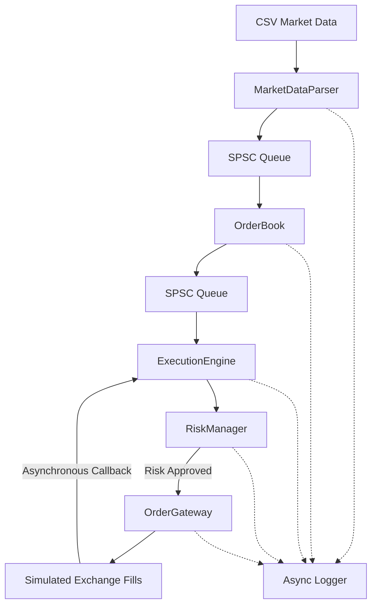

# Cpp23DebuggingLab

### Advanced C++23 Debugging & Troubleshooting in Multithreaded Trading Systems


## Project Overview

Cpp23DebuggingLab is a hands-on debugging laboratory built around a realistic multithreaded trading and market data processing system implemented in modern C++.

The project focuses on investigating, diagnosing, and resolving realistic software defects commonly encountered in complex C++ systems, including financial trading platforms, real-time applications, and concurrent Linux services.

Rather than focusing exclusively on implementing new features, this laboratory emphasizes understanding existing codebases, analyzing runtime behavior, identifying root causes, and implementing minimal, validated fixes.

Each debugging scenario introduces an isolated defect into an otherwise healthy reference implementation.

## Engineering Objectives

- Debug complex, multithreaded C++ codebases.
- Investigate crashes and undefined behavior.
- Analyze stack traces and runtime diagnostics.
- Identify memory corruption and object lifetime violations.
- Diagnose data races and synchronization failures.
- Reason about atomic memory ordering and happens-before relationships.
- Investigate performance regressions.
- Preserve existing architecture while implementing minimal fixes.
- Validate corrections through automated regression testing.
- Produce reproducible, professional technical investigation reports.

## Debugging Progress

**5 of 10 scenarios completed — 50%**

| Scenario | Reported Symptom | Debugging Tools | Status |
|---|---|---|---|
| 01 | Top-of-book occasionally reports bid above ask | GDB, GoogleTest | Completed |
| 02 | Feed handler crashes on a malformed input line | GDB | Completed |
| 03 | Garbage output or crash after an order fills | ASan, UBSan | Completed |
| 04 | Heap corruption under sustained load | GDB, ASan, UBSan | Completed |
| 05 | Consumer observes a price that was never sent | TSan | Completed |
| 06 | Risk limit is sometimes not enforced under load | TBD | Pending |
| 07 | Simulation hangs indefinitely | TBD | Pending |
| 08 | Feed processing has become much slower | TBD | Pending |
| 09 | Order exactly at the risk limit is handled inconsistently | TBD | Pending |
| 10 | Very large order produces a nonsensical notional value | TBD | Pending |

## Completed Technical Investigations

### Scenario 01 — Order Book Consistency

- Investigated incorrect top-of-book behavior.
- Analyzed order cancellation and replacement operations.
- Identified incorrect handling of empty price levels.
- Restored order book invariants.
- Validated the correction through regression testing.

[Original Challenge](../../tree/buggy/scenario-01) | [Solution and Investigation](../../tree/scenario/01)

### Scenario 02 — Malformed Market Data

- Investigated a crash triggered by malformed market data.
- Analyzed parser behavior using GDB.
- Identified the underlying input-processing defect.
- Corrected the implementation and validated parser robustness.

[Original Challenge](../../tree/buggy/scenario-02) | [Solution and Investigation](../../tree/scenario/02)

### Scenario 03 — Heap Use-After-Free

- Investigated a memory safety violation in order-fill processing.
- Analyzed AddressSanitizer diagnostic reports.
- Identified an object lifetime violation involving an erased container element.
- Corrected resource lifetime handling.
- Validated the fix using sanitizer-enabled regression tests.

[Original Challenge](../../tree/buggy/scenario-03) | [Solution and Investigation](../../tree/scenario/03)

### Scenario 04 — Ring Buffer Overflow

- Investigated invalid memory access in a bounded SPSC queue.
- Analyzed GDB stack frames and runtime variable values.
- Identified an inconsistency between logical queue capacity and allocated storage.
- Implemented a minimal correction.
- Validated queue capacity, wraparound, and sustained-load behavior.

[Original Challenge](../../tree/buggy/scenario-04) | [Solution and Investigation](../../tree/scenario/04)

### Scenario 05 — Lock-Free Queue Data Race

- Investigated unsafe concurrent access to a non-atomic ring buffer.
- Analyzed conflicting producer and consumer memory accesses using ThreadSanitizer.
- Identified incorrect relaxed atomic memory ordering.
- Restored acquire/release synchronization in both directions.
- Preserved the lock-free SPSC architecture without introducing mutexes.
- Distinguished sanitizer instrumentation overhead from concurrency failures.
- Validated the final implementation with all 57 ThreadSanitizer tests passing.

[Original Challenge](../../tree/buggy/scenario-05) | [Solution and Investigation](../../tree/scenario/05)

[Detailed Investigation Report](../../blob/scenario/05/docs/debugging/scenario-05-investigation.md)

## Debugging Methodology

The investigations follow a systematic engineering workflow:

```text
Observe the failure
        |
Reproduce the defect
        |
Isolate the failing test
        |
Collect runtime diagnostics
        |
Analyze the source code
        |
Identify the root cause
        |
Implement a minimal fix
        |
Run regression tests
        |
Review and document the solution
```

Each investigation prioritizes evidence-driven debugging rather than speculative code changes.

## Debugging Tools

| Tool | Application |
|---|---|
| GDB | Stack traces, breakpoints, stack frames, runtime variable inspection |
| AddressSanitizer (ASan) | Heap use-after-free, buffer overflows, invalid memory access |
| UndefinedBehaviorSanitizer (UBSan) | Selected undefined behavior detection |
| ThreadSanitizer (TSan) | Data races and synchronization failures |
| GoogleTest | Unit and integration testing |
| CTest | Test isolation and regression validation |
| Git | Source comparison, defect tracking, minimal fix verification |
| CMake / Ninja | Multiple build configurations and incremental compilation |

### Technical Guides

Reusable debugging guides developed during the investigations:

- [AddressSanitizer — Practical C++ Debugging Guide](../../blob/scenario/03/docs/debugging/ASAN_GUIDE.md)
- [ThreadSanitizer — Practical C++ Debugging Guide](../../blob/scenario/05/docs/debugging/TSAN_GUIDE.md)

## System Architecture

The laboratory simulates a multithreaded market data and order execution pipeline.



### Threading Model

The system uses dedicated worker threads for:

- Market data ingestion and parsing.
- Order book updates and top-of-book signal generation.
- Order execution and pre-trade risk validation.
- Asynchronous exchange simulation and fill callbacks.
- Asynchronous structured logging.

Bounded SPSC queues connect the primary pipeline stages.

### Key Components

| Component | Responsibility |
|---|---|
| MarketDataParser | CSV market data parsing and typed error handling |
| SPSCQueue | Bounded single-producer/single-consumer ring buffer |
| OrderBook | Order management and best bid/ask calculation |
| ExecutionEngine | Trading decisions and order lifecycle management |
| OrderGateway | Asynchronous exchange simulation |
| RiskManager | Pre-trade risk validation |
| PositionTracker | Position and notional tracking |
| Logger | Asynchronous structured logging |
| MarketDataFeedHandler | Multithreaded pipeline orchestration |

## Modern C++ Features

The project uses C++20 and C++23 features, including:

- `std::expected`
- `std::jthread`
- `std::stop_token`
- `std::atomic`
- Acquire/release memory ordering
- C++ Concepts
- `std::source_location`
- `std::format`
- `std::print` and `std::println`
- `std::flat_map`, with a `std::map` fallback
- `std::stacktrace`, when supported by the toolchain
- Designated initializers
- RAII-based resource management

Optional standard library features are detected during CMake configuration.

## Repository Structure

```text
Cpp23DebuggingLab/
├── apps/
├── data/
├── docs/
│   ├── AI_DEVELOPMENT.md
│   └── scenarios/
├── include/
│   └── mdlab/
│       ├── core/
│       ├── execution/
│       ├── logger/
│       ├── marketdata/
│       ├── orderbook/
│       ├── pipeline/
│       ├── risk/
│       └── util/
├── prompts/
├── src/
├── tests/
├── CMakeLists.txt
├── CMakePresets.json
└── README.md
```

Investigation reports and additional debugging guides are available on the completed scenario branches.

## Branch and Tag Organization

| Reference | Purpose |
|---|---|
| `main` | Project overview and reference codebase |
| `baseline` | Healthy reference implementation |
| `scenario/01` — `scenario/05` | Completed investigations and fixes |
| `scenario/06` — `scenario/10` | Pending debugging challenges |
| `buggy/scenario-01` — `buggy/scenario-05` | Preserved original defective implementations |

Original debugging challenges are preserved using annotated Git tags, allowing developers to reproduce and investigate defects independently.

## Build Requirements

- Linux
- C++23-compatible compiler and standard library
- GCC 15 (development toolchain)
- CMake 3.25 or newer
- Ninja
- GoogleTest

## Building and Running

Clone the repository:

```bash
git clone https://github.com/somayehhajabedi/Cpp23DebuggingLab.git
cd Cpp23DebuggingLab
```

Switch to the healthy reference implementation:

```bash
git switch baseline
```

Configure, build, and test:

```bash
cmake --preset debug
cmake --build --preset debug
ctest --preset debug --output-on-failure
```

Run the trading simulation:

```bash
./build/debug/simulation data/sample_ticks.csv
```

## Build Configurations

| Preset | Purpose |
|---|---|
| `debug` | Standard debugging and functional testing |
| `release` | Optimized build with debugging information |
| `asan-ubsan` | Memory safety and undefined behavior detection |
| `tsan` | Concurrent execution and data race detection |

Each preset uses an independent build directory.

### Memory Safety Validation

```bash
cmake --preset asan-ubsan
cmake --build --preset asan-ubsan
ctest --preset asan-ubsan --output-on-failure
```

### Concurrency Validation

```bash
cmake --preset tsan
cmake --build --preset tsan
ctest --preset tsan --output-on-failure
```

AddressSanitizer and ThreadSanitizer require separate build configurations.

Sanitizer instrumentation can significantly affect execution time. Performance benchmarks should be evaluated independently using optimized, non-sanitized builds.

## Practice a Debugging Challenge

To investigate a completed scenario without viewing its solution, create a local practice branch from its original tag:

```bash
git switch -c practice/05 buggy/scenario-05
```

Configure and build:

```bash
cmake --preset tsan
cmake --build --preset tsan
```

Reproduce the failure:

```bash
ctest --preset tsan --output-on-failure
```

Investigate the defect, identify its root cause, implement a correction, and validate your solution before reviewing the completed investigation.

For a pending scenario, switch directly to the corresponding scenario branch.

See the [Scenario Catalog](docs/scenarios/00-index.md) for the original bug reports.

## Automated Testing

The reference implementation includes 57 regression tests covering:

- Market data parsing
- Order book invariants
- Queue capacity and wraparound
- Concurrent queue data integrity
- Order lifecycle management
- Position tracking
- Risk management
- Risk limit boundaries
- Concurrent risk snapshots
- Notional overflow
- Pipeline liveness
- Logging
- Simulation throughput

The same regression suite is used to reproduce and validate the debugging scenarios.

## Continuous Integration

The project includes GitHub Actions configuration for building and testing the Debug and ASan/UBSan presets on the main and baseline branches.

Intentionally defective scenario branches are excluded from the standard CI workflow.

## AI-Assisted Development

The initial application codebase, baseline tests, and debugging scenarios were generated with AI assistance.

The subsequent investigations focus on human-led debugging, runtime analysis, root cause identification, implementation of corrections, and verification through actual execution of debugging tools and regression tests, with AI assistance where appropriate.

This distinction is intentional: the primary objective is to demonstrate practical debugging and engineering reasoning rather than claim sole authorship of the initial generated codebase.

See [AI Development Documentation](docs/AI_DEVELOPMENT.md) for additional context.

## Project Status

- [x] Reference implementation
- [x] Automated regression test suite
- [x] Independent sanitizer configurations
- [x] Scenario 01 investigation
- [x] Scenario 02 investigation
- [x] Scenario 03 investigation
- [x] Scenario 04 investigation
- [x] Scenario 05 investigation
- [ ] Scenario 06 investigation
- [ ] Scenario 07 investigation
- [ ] Scenario 08 investigation
- [ ] Scenario 09 investigation
- [ ] Scenario 10 investigation

This project is under active development.

---

**Reproduce. Investigate. Understand. Fix. Validate.**
